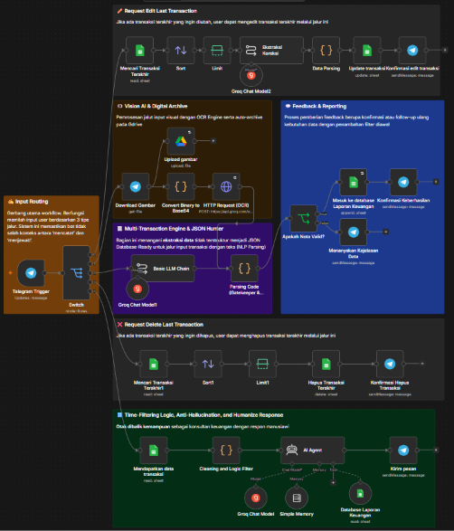

# Personal AI Finance Assistant

A personal finance tracking system built with n8n, Telegram, AI, Vision/OCR, Google Sheets, and Looker Studio.

## Problem

Manually recording daily income and expenses can be time-consuming, especially when transactions come from different sources such as text messages and receipts.

## Solution

I built an AI-powered workflow that allows me to record transactions through Telegram.

Users can send a text message or receipt image. The workflow processes the input using AI and Vision/OCR, extracts the transaction details, and stores structured records in Google Sheets.

The data is then connected to Looker Studio for financial reporting and visualization.

## My Contribution

I designed and built the workflow, including:

- Telegram Bot integration
- n8n workflow orchestration
- AI processing and receipt data extraction
- Google Sheets integration
- Looker Studio dashboard connection

## Tech Stack

- n8n
- Telegram Bot API
- AI / Vision / OCR
- Google Sheets
- Looker Studio

## Workflow

1. Receive transaction input through Telegram.
2. Identify whether the input is text or a receipt image.
3. Process the input using AI and Vision/OCR.
4. Extract and structure transaction details.
5. Save the records to Google Sheets.
6. Display financial data through Looker Studio.

## Workflow Overview

## Dashboard Preview

.png)
.png)

## Current Status

The system is working as a personal finance assistant. Formal benchmarks for extraction accuracy and time savings have not yet been conducted.

## Setup

Import the workflow JSON into your own n8n instance and configure your own Telegram, AI, and Google Sheets credentials before running it.

**Note:** This repository does not contain API keys, credentials, or personal financial data.
